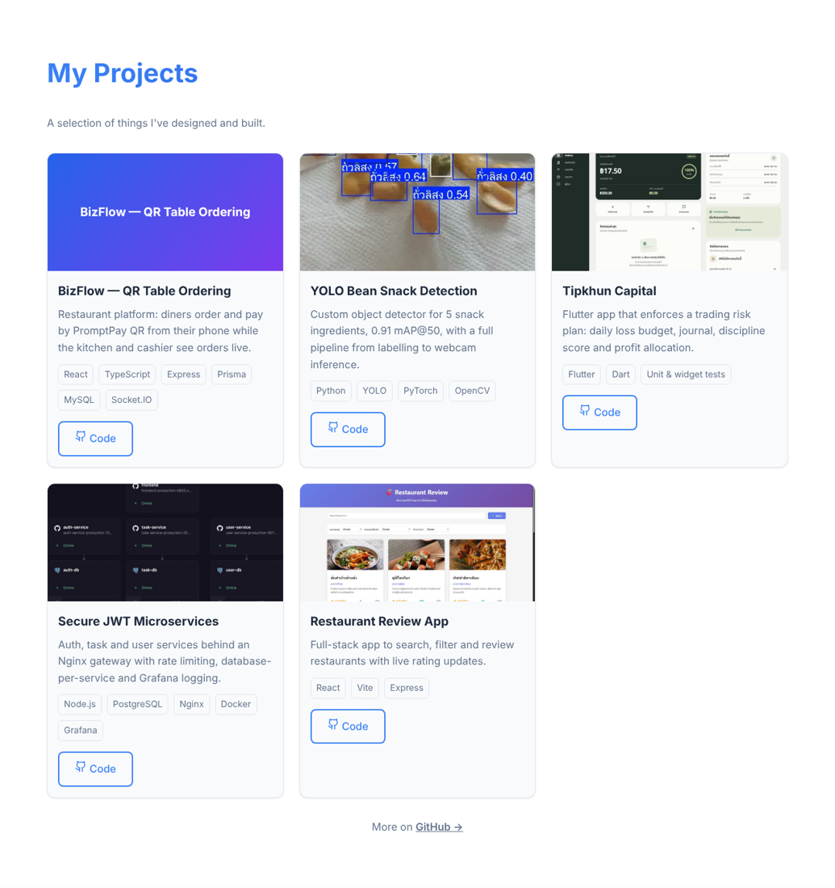

# Personal Portfolio — React

**My single-page portfolio built with React and Vite: an About section, project cards rendered from a data file, a validated contact form and a persisted light/dark theme.**


> Built during **ENGSE203, Lab 3: React.js Fundamentals**, then updated with my current projects.



## How it's built

- **Data-driven projects:** cards are generated from `src/data/portfolioData.js`, so adding a project means adding one object
- **Theme context:** `ThemeContext` + `ThemeToggle` switch light/dark mode and remember the choice
- **Contact form:** client-side validation, then it opens the visitor's email app with the message pre-filled (no backend needed)
- **Responsive header** with a mobile menu and smooth scrolling between sections
- **SPA routing on Vercel** via `public/_redirects`

```
src/
  components/   Header, About, Projects (ProjectCard), Contact, ThemeToggle
  contexts/     ThemeContext
  data/         portfolioData.js — the project list
```

## Run

```bash
git clone https://github.com/tawan230666/LAB3_Reactjs_Fundamentals.git
cd LAB3_Reactjs_Fundamentals
npm install
npm run dev         # npm run build for production
```

---

**Author:** Tawan Tiphkun (ธาวัน ทิพคุณ), [@tawan230666](https://github.com/tawan230666), Software Engineering, RMUTL Chiang Mai
